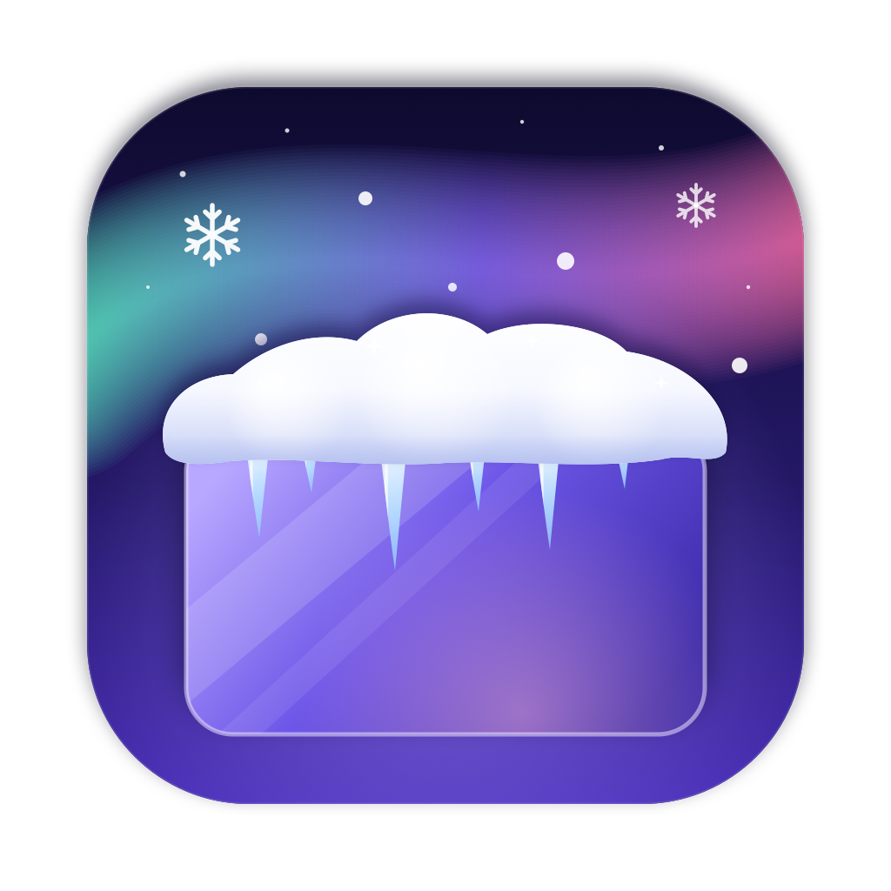
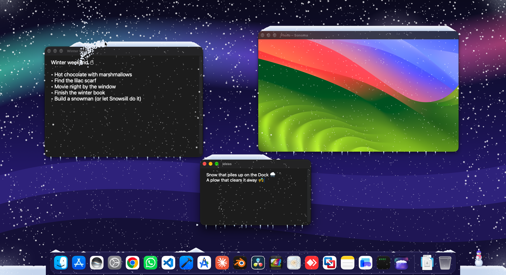
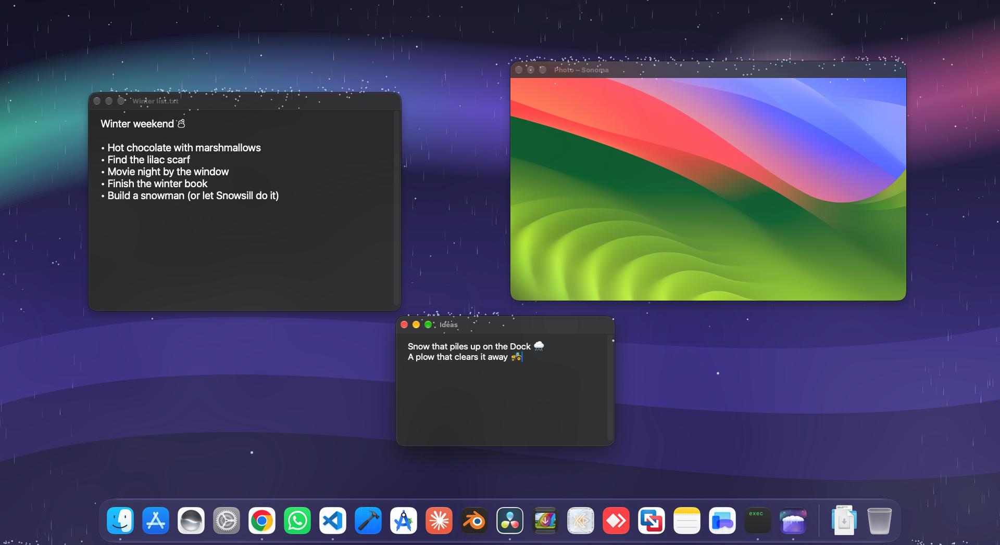
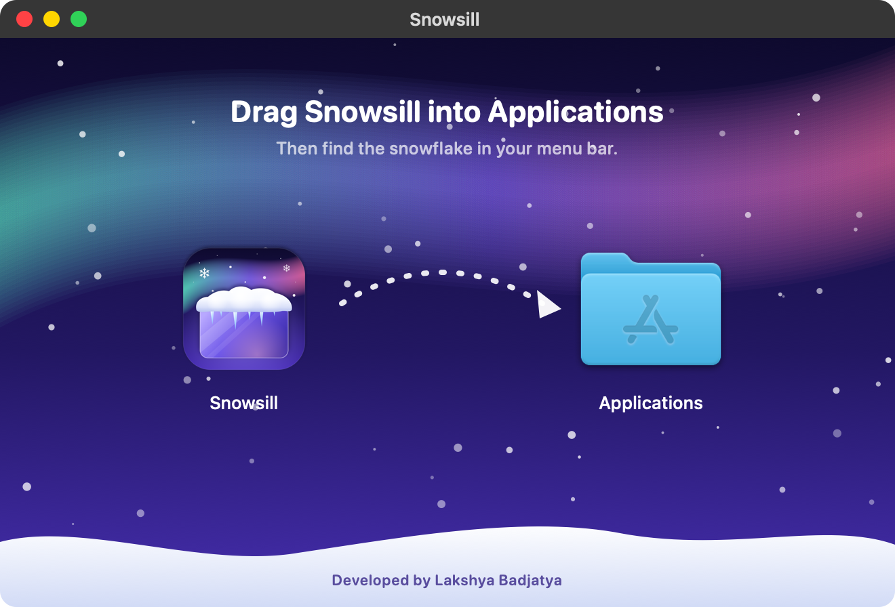
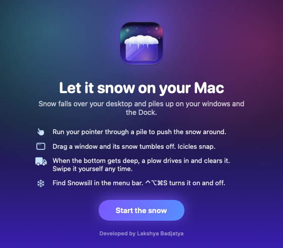
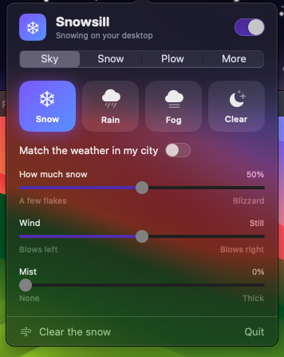
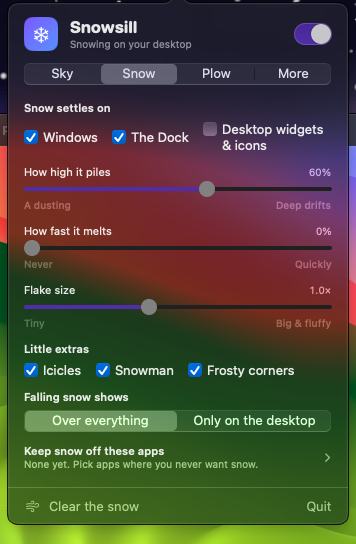
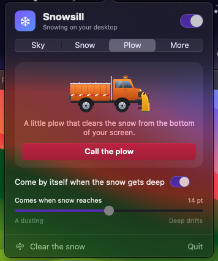
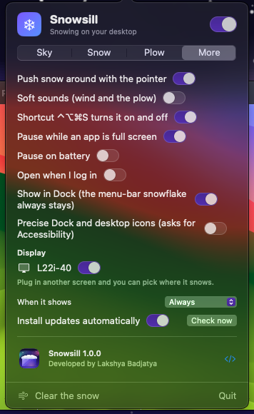

  

<h1 align="center">Snowsill — Snow on your Mac desktop</h1>

  <b>Let it snow on your Mac.</b> Snow falls over your desktop and piles up on your windows, the Dock and your widgets. 
  Push it around with your pointer, watch icicles grow, and let a little snow plow clear it all away.

  <a href="https://github.com/LakshyaBadjatya/Snowsill/releases/latest"><b>⬇︎ Download Snowsill for Mac</b></a>
  &nbsp;·&nbsp; Free &nbsp;·&nbsp; macOS 15 Sequoia or later &nbsp;·&nbsp; Apple silicon

<i>Developed by <b>Lakshya Badjatya</b></i>

  

---

## Contents

- [What is Snowsill?](#what-is-snowsill)
- [Features](#features)
- [Download and install](#download-and-install)
- [Using Snowsill](#using-snowsill)
- [The snow plow](#the-snow-plow)
- [Rain, fog and live weather](#rain-fog-and-live-weather)
- [Performance and battery](#performance-and-battery)
- [Privacy](#privacy)
- [System requirements](#system-requirements)
- [FAQ](#faq)
- [Troubleshooting](#troubleshooting)
- [Uninstall](#uninstall)
- [Credits and license](#credits-and-license)

---

## What is Snowsill?

Snowsill is a **macOS menu bar app that makes it snow on your desktop**. Real snowflakes drift down over everything you have open, settle on the **top edge of every window**, build soft drifts on the **Dock** and your **desktop widgets**, and react to what you do. It is a cosy, playful **winter desktop effect** for your Mac, light enough to leave running all day.

The name comes from a *window sill*, the ledge where snow settles.

---

## Features

### ❄️ Snow that piles up on your windows and Dock
Flakes land on the top edge of every window and on the Dock and build up into soft, rounded drifts that follow your windows' rounded corners. Windows in front hide the snow on windows behind them, just like in real life.

### 🖱️ Push the snow with your pointer
Run your cursor through a pile and the snow flies off and tumbles down. Move a window and its snow slides off. Close it and the snow drops and melts away.

### 🚜 The snow plow
When the bottom of your screen gets deep, a little snow plow truck drives in with its amber beacon flashing, pushes all the snow off the edge of the screen, knocks over the snowman and drives away. You can also call it whenever you like.

### 🧊 Icicles, a snowman and frosty corners
- **Icicles** slowly grow under your windows while it snows, and snap off when you move the window.
- **A snowman** builds itself when the snow on the ground gets deep, complete with a lilac beanie and a pink scarf.
- **Frost** creeps in from the corners of your screen during a long, heavy snowfall, and the plow clears it.

### 🌧️ Rain and 🌫️ fog
Switch to rain with splashes on your windows, or a slow drifting fog. Add wind to blow it all sideways.

### 🌍 Match the real weather
Type your city and Snowsill matches its current weather: snow when it snows, rain when it rains, fog when it is foggy, with real wind.

### 🙈 Stays out of your way
- **Desktop only:** falling snow stays behind your app windows and never covers your work.
- **Keep snow off chosen apps:** pick apps where you never want snow.
- **One switch per display** if you use more than one screen.
- **Pause** automatically in full-screen apps, on battery, outside winter months or outside evenings.
- **⌃⌥⌘S** turns the weather on and off from anywhere.

### 🔄 Automatic updates
Snowsill checks for updates when it starts and once a day, downloads new versions quietly and installs them the next time it restarts.

---

## Download and install

1. **Download** the latest `Snowsill.dmg` from the [Releases page](https://github.com/LakshyaBadjatya/Snowsill/releases/latest).
2. **Open** the DMG and **drag Snowsill into Applications**.

   

3. **Open Snowsill** from Applications or Launchpad.
4. If macOS says it **cannot verify the developer**, open **System Settings → Privacy & Security**, scroll down and click **Open Anyway** next to Snowsill, then confirm. You only need to do this once.
5. A welcome screen appears. Click **Start the snow**. ❄️

Snowsill lives in your **menu bar** (the snowflake ❄︎) and, if you like, in your **Dock**. Click either one to open its settings.

---

## Using Snowsill

Click the snowflake in the menu bar. The menu has four tabs.

<table>
<tr>
<td align="center" width="25%"> <b>Sky</b></td>
<td align="center" width="25%"> <b>Snow</b></td>
<td align="center" width="25%"> <b>Plow</b></td>
<td align="center" width="25%"> <b>More</b></td>
</tr>
</table>

| Tab | What you can do |
|---|---|
| **Sky** | Pick **Snow, Rain, Fog or Clear**. Set how much falls, the wind and the mist. Turn on **Match the weather in my city**. |
| **Snow** | Choose where snow settles (**windows, the Dock, desktop widgets & icons**), how high it piles, how fast it melts and the flake size. Turn **icicles, the snowman and frosty corners** on or off. Choose whether falling snow shows **over everything** or **only on the desktop**. Pick apps to keep snow-free. |
| **Plow** | **Call the plow**, or let it **come by itself** when the snow reaches a depth you choose. |
| **More** | Pointer pushing, soft sounds, the ⌃⌥⌘S shortcut, pausing in full screen or on battery, open at login, Dock icon, which **displays** get snow, the **schedule**, automatic updates and the precise Dock option. |

The **switch at the top** turns everything on and off. **Clear the snow** at the bottom removes all the snow at once.

### Tips
- **Drag a window** to shake its snow off.
- **Close a window** and its snow melts away.
- Snow on a window you **minimise** or move to **another desktop** is kept until it comes back.
- Turn on **Soft sounds** for quiet wind and the plow's engine and beep.

---

## The snow plow

- **Call the plow** in the Plow tab. The truck drives in, lowers its blade, pushes the snow off the edge of the screen, comes back the other way if any is left, and drives off.
- **Let it come by itself:** with *Come by itself when the snow gets deep* on, the plow arrives on its own once the snow at the bottom reaches the depth you set.
- The plow also clears the **frosty corners** and will knock over the **snowman**.

---

## Rain, fog and live weather

- **Rain** falls fast, splashes on window tops and the Dock, drips from window corners and slowly melts any snow.
- **Fog** drifts across the screen and moves with the wind.
- **Match the weather in my city:** type a city (for example *Tokyo*, *Oslo* or *New York*) and Snowsill shows its current weather, updated every 15 minutes, using the free [Open-Meteo](https://open-meteo.com) weather service. Until the weather loads, your own settings are used.

---

## Performance and battery

Snowsill draws everything on the GPU with **Metal**, in one transparent layer over your screen.

- Around **3–4% CPU** while snowing on a modern Mac, measured with 4,000 flakes in the air.
- **0 dropped frames** in normal use, including while the plow is driving.
- When nothing is moving it **stops drawing entirely**.
- It can **pause automatically** in full-screen apps, on battery, at night or outside winter.

---

## Privacy

Snowsill **collects no personal data**: no accounts, no analytics, no tracking.

- It reads **where windows are** (never what is in them) so snow can land on them. It needs **no Screen Recording permission**.
- The only things it sends over the internet are an optional **city name** for live weather and an **update check**.

Full details: [PRIVACY.md](PRIVACY.md).

---

## System requirements

- **macOS 15 Sequoia or later**
- A Mac with **Apple silicon** (M1 or later)
- About **6 MB** of disk space

---

## FAQ

**Is Snowsill free?**
Yes, Snowsill is free to download and use.

**Will it slow my Mac down?**
No. It uses the GPU, about 3–4% CPU while snowing, and nothing when idle. You can also have it pause on battery.

**Can I click through the snow?**
Yes. The snow layer is click-through, so you use your Mac exactly as normal. The only thing you can grab is the plow truck while it is parked.

**Why does it ask for Accessibility permission?**
It only asks if you turn on *Precise Dock and desktop icons* in the More tab, to read the exact size of the Dock and where your desktop icons are. Everything else works without it.

**Does it work with multiple displays?**
Yes. Each display gets its own switch in the More tab.

**Does it work in full-screen apps and videos?**
By default Snowsill pauses while an app is full screen. You can change that in the More tab.

**How do I make snow stay off my work?**
Choose *Only on the desktop* in the Snow tab, or add apps to *Keep snow off these apps*.

**Can I use my real local weather?**
Yes. Turn on *Match the weather in my city* in the Sky tab and type your city.

---

## Troubleshooting

| Problem | Fix |
|---|---|
| macOS won't open Snowsill | System Settings → Privacy & Security → **Open Anyway** (see [install](#download-and-install)). |
| No snow appears | Make sure the switch at the top of the menu is on, and the Sky tab isn't set to *Clear*. Check the **schedule** and **display** switches in the More tab, and that you're not in a full-screen app. |
| Snow sits slightly off the Dock's edges | Turn on *Precise Dock and desktop icons* in the More tab and allow Accessibility. |
| Snow covers something I'm working on | Use *Only on the desktop* or add the app to *Keep snow off these apps*. |
| I lost the menu bar icon | Open Snowsill from Applications; it opens its settings. You can also turn *Show in Dock* on. |

Still stuck? [Open an issue](https://github.com/LakshyaBadjatya/Snowsill/issues).

---

## Uninstall

1. Open the Snowsill menu and click **Quit**.
2. Drag **Snowsill** from Applications to the Trash.
3. Optional: remove its settings by deleting `~/Library/Preferences/app.snowsill.mac.plist`.

---

## Credits and license

**Snowsill is developed by Lakshya Badjatya.** © 2026 Lakshya Badjatya. All rights reserved.

The source code is public so you can see exactly what the app does, report problems and suggest improvements. It is **source-available, not open for reuse**: you may not copy, redistribute, rebrand or sell it. See [LICENSE](LICENSE).

Live weather by [Open-Meteo](https://open-meteo.com). Updates by [Sparkle](https://sparkle-project.org).

Snowsill · snow on Mac desktop · macOS snow app · snow that piles up on windows · winter desktop effect · menu bar weather app · let it snow on Mac

